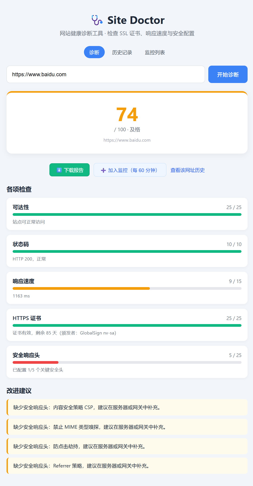
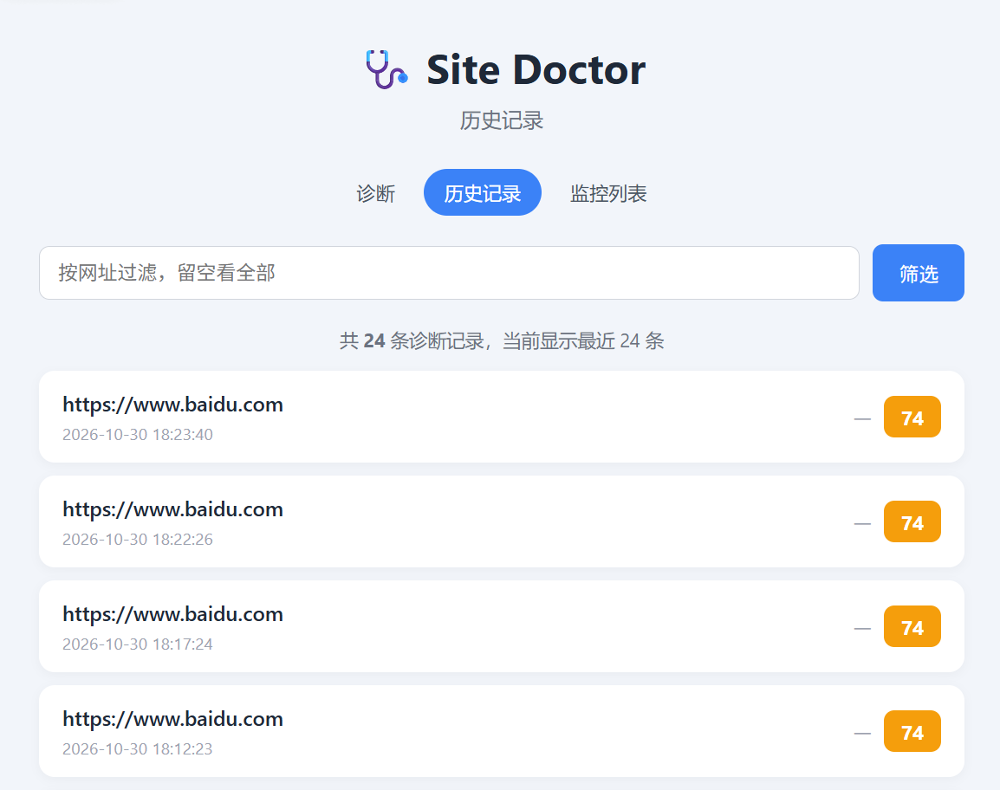
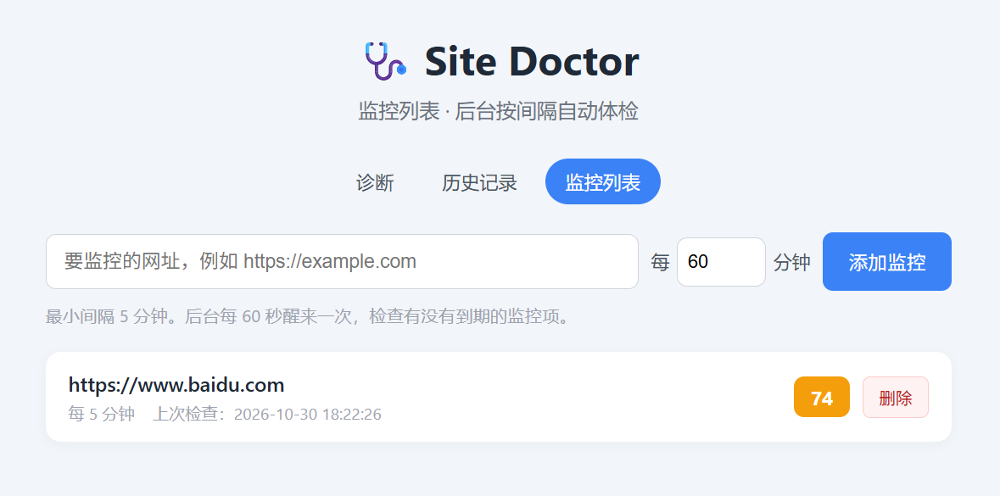

# 🩺 Site Doctor — 网站健康诊断工具

输入一个网址，自动检查 SSL 证书、响应速度与安全配置，输出 **0–100 分** 的体检报告和中文改进建议。
支持**历史记录**、**定时监控**、**JSON API** 与**报告导出**：把网址加入监控后，后台会按间隔自动体检，证书快过期时在页面顶部提醒。

> 个人项目 / 用于简历与面试展示。核心目标是：**小而完整、能真实运行、有可以讲的工程点**。
> 项目分三版迭代：v1 基础诊断 → v2 数据持久化与后台调度 → v3 性能优化与可复用接口。



---

## 界面预览

| 历史记录 | 监控列表 |
| --- | --- |
|  |  |

---

## 功能

### v1：诊断与评分

| 检查项 | 说明 | 满分 |
| --- | --- | --- |
| 可达性 | 站点能否正常建立连接并返回响应 | 25 |
| 状态码 | HTTP 2xx / 3xx / 4xx / 5xx 分级评分 | 10 |
| 响应速度 | 按耗时档位给分（≤300ms 满分，>5s 零分） | 15 |
| HTTPS 证书 | 是否启用 HTTPS、证书是否有效、剩余天数 | 25 |
| 安全响应头 | HSTS / CSP / X-Content-Type-Options / X-Frame-Options / Referrer-Policy | 25 |

评分的同时输出对应建议，分数低的地方一定能在建议里找到原因。

### v2：历史记录 + 定时监控

- **自动落库**：每次诊断都会保存到 SQLite，诊断失败或写库失败都不会影响页面展示；
- **历史记录页**（`/history`）：列出全部记录，可按网址筛选，显示分数涨跌（▲/▼），点进去可回看当时完整报告；
- **监控列表**（`/monitors`）：添加/删除要定期体检的网址，设置检查间隔（最小 5 分钟）；
- **后台定时检查**：应用启动后自动拉起调度循环，按每个监控项的间隔跑诊断并落库；
- **证书到期提醒**：证书剩余不足 30 天的监控项，会在所有页面顶部弹出醒目提示。

### v3：性能优化与接口化

- **并发检测**：HTTP 请求与 SSL 证书检测改为并行（`ThreadPoolExecutor`），实测总耗时降低约 **1.5 倍**；
- **TTL 缓存**：同一网址 60 秒内重复诊断直接复用结果，实测从 ~770ms 降到 **0.02ms**，页面会标记「来自缓存」；
- **JSON API**：`GET /api/check?url=` 返回结构化 JSON，供脚本或其他程序调用；
- **报告导出**：`GET /report?url=` 下载自包含 HTML 报告，内嵌样式、无外部依赖，离线可打开；
- **性能对比工具**：`python benchmark.py` 实测串行与并发的耗时差。

## 快速开始

```bash
cd site-doctor

# 1. 安装依赖
pip install -r requirements.txt

# 2. 启动服务
python -m uvicorn app.main:app --host 127.0.0.1 --port 8000

# 3. 浏览器打开
# http://127.0.0.1:8000
```

Windows 下也可以直接双击 `run.bat` 启动。

首次启动会自动在 `data/site_doctor.db` 建库，无需手动初始化。

输入网址（可以不写 `https://`，会自动补全）即可看到报告。

> Windows 下如果 `--reload` 报 `WinError 5`，去掉 `--reload` 参数即可（改代码后手动重启）。

## 运行测试

```bash
python -m pytest -q
```

共 85 个用例，覆盖诊断引擎、评分逻辑、存储层、证书到期判断、缓存与报告生成。测试全部离线运行（网络调用用 mock 隔离）。

## 性能对比

```bash
python benchmark.py              # 默认测 3 个站点
python benchmark.py --repeat 2   # 每个站点测 2 轮取平均
```

在本机实测（2026-10，每站点 2 轮平均）：

| 网址 | 串行(ms) | 并发(ms) | 提速 |
| --- | --- | --- | --- |
| https://www.baidu.com | 1271 | 747 | 1.70x |
| https://www.bing.com | 1434 | 1027 | 1.40x |
| https://terraria.wiki.gg | 3023 | 2098 | 1.44x |
| **合计** | **5728** | **3872** | **1.48x** |

## JSON API

```bash
curl "http://127.0.0.1:8000/api/check?url=https://www.baidu.com"
```

返回示例（节选）：

```json
{
  "url": "https://www.baidu.com",
  "reached": true,
  "status_code": 200,
  "elapsed_ms": 753.2,
  "from_cache": false,
  "score": 74,
  "grade": "及格",
  "breakdown": [{"name": "可达性", "score": 25, "max": 25, "detail": "站点可正常访问"}],
  "suggestions": ["缺少安全响应头：内容安全策略 CSP，建议在服务器或网关中补充。"]
}
```

> API 刻意**不写库**：脚本批量调用会很频繁，写库会把「诊断历史」淹没。

## 项目结构

```
site-doctor/
├── app/
│   ├── main.py       # FastAPI 入口、路由、lifespan 启动钩子
│   ├── checker.py    # 诊断引擎：HTTP + SSL 并行检测
│   ├── scoring.py    # 评分与建议生成
│   ├── storage.py    # SQLite 存储：诊断历史 + 监控列表
│   ├── monitor.py    # 后台调度循环、证书到期判断
│   ├── cache.py      # TTL 缓存（v3）
│   └── report.py     # 自包含 HTML 报告生成（v3）
├── templates/
│   ├── index.html        # 首页：表单 + 结果页
│   ├── history.html      # 历史记录页
│   ├── monitors.html     # 监控列表页
│   └── _cert_alerts.html # 证书提醒片段（多处 include）
├── static/
│   ├── style.css
│   └── favicon.svg
├── tests/
│   ├── conftest.py       # 公用夹具（独立测试库）
│   ├── test_checker.py
│   ├── test_scoring.py
│   ├── test_storage.py
│   ├── test_monitor.py
│   ├── test_cache.py     # (v3)
│   └── test_report.py    # (v3)
├── data/                 # SQLite 数据库（运行时生成，不入库）
├── benchmark.py          # 串行 vs 并发 性能对比（v3）
├── requirements.txt
├── pytest.ini
└── run.bat
```

分层思路：**checker 只负责「采集事实」，scoring 只负责「判断好坏」，storage 只管「存取」，monitor 只管「调度」**。每层都不关心其他层的细节，可以独立测试、独立修改。

## 有一定难度、面试可以讲的工程点

### 1. SSL 证书：为什么不能一上来就用 `CERT_NONE`

最初的做法是关闭证书验证（`verify_mode = ssl.CERT_NONE`）去读证书信息，结果 `getpeercert()` 返回 **空字典 `{}`** —— Python 在关闭验证时不会解析证书字段，只留二进制形式。

**解法：两次握手**

1. 先用**正常验证**握手，绝大多数站点走这条路，能直接拿到 `notAfter`、`issuer`；
2. 如果验证失败（自签名 / 过期证书），再降级为不验证，拿 `binary_form` 的 DER 字节，用 `cryptography` 库解析出过期时间。

这样既能对「证书正常」的站点给出完整信息，又能在「证书有问题」时告诉用户**具体是什么问题、还有几天过期**。

### 2. 超时兜底，否则一个坏站点拖垮整个服务

所有网络请求都设了 5 秒超时，并把 `httpx.TimeoutException` / `httpx.HTTPError` 捕获成报告里的 `error` 字段，而不是让异常冒泡。实测访问国内无法直连的站点会稳定在 ~5s 返回“请求超时”，页面不会卡死。

### 3. 单项失败不影响整体报告

HTTP 请求失败时，**仍然会继续检测 SSL 证书**。否则会出现「网址写的是 https，报告却显示非 HTTPS 站点」这种自相矛盾的结果 —— 这个 bug 是在真实测试不存在的域名时发现的。

### 4. 后台调度：为什么用 asyncio 而不是 APScheduler

需求很简单（按间隔检查），引入调度框架属于过度设计。用 `asyncio.create_task` + 60 秒轮询即可，原理清楚、零额外依赖。

**关键点**：诊断本身是同步阻塞的网络请求，必须用 `asyncio.to_thread` 丢到线程池，否则会卡死整个事件循环，导致 Web 页面也打不开。这是「同步代码跑在异步框架里」最典型的坑。

另外，调度循环用 `try/except` 包住每一轮，保证**单轮异常不会让循环静默退出**——否则监控会悄悄失效而没人发现。

### 5. 默认参数的坑（测试里踩到的）

`storage` 各函数写的是 `db_path: Path = DB_PATH`。这个默认值在**函数定义时**就绑定了，所以测试里 `monkeypatch.setattr(storage, "DB_PATH", 临时路径)` 根本不生效，导致测试写到了真实数据库。

这是 Python 默认参数绑定时机的经典陷阱。最终改为使用独立测试库 + 包装器显式传参解决。

### 6. 分数和建议必须对得上

评分拆成 5 个维度，每个维度同时产出「得分」和「扣分原因」，建议文案直接来自扣分原因，避免出现“分数很低但不知道为什么”。

### 7. 并发优化：找出「没有依赖关系却串行执行」的浪费（v3）

HTTP 请求和 SSL 证书检测**都只依赖域名**，彼此没有先后关系，但 v1/v2 里是串行写的：

```python
http_result = fetch(url)        # 等 700ms
ssl_result = check_ssl(host)    # 再等 500ms，纯属浪费
```

改成 `ThreadPoolExecutor` 并行后，总耗时接近两者中较慢的那个。实测合计从 5728ms 降到 3872ms，**提速 1.48 倍**（Bing 单站 1.40x，百度 1.70x）。

**讲点**：优化的第一步不是写更快的代码，而是**找可以并行的部分**。这类「串行调用互不依赖」是实际项目里最常见的性能浪费。

### 8. 缓存策略：只缓存成功结果（v3）

TTL 缓存实现很简单，真正需要想清楚的是**什么不该缓存**：

- 超时、连接失败属于临时故障 —— 缓存住会让用户重试也拿不到新结果；
- 只缓存 `reached=True` 且无 `error` 的报告。

另外两个细节：
- **线程安全**：后台监控跑在线程池，Web 请求在主线程，会同时读写缓存，所以必须加锁；
- **返回副本**：缓存里存的是原始对象，返回前做浅拷贝，防止调用方改坏缓存。

实测命中时从 ~770ms 降到 0.02ms。

### 9. 报告导出的安全点：HTML 转义（v3）

导出的报告把用户输入的网址、检测结果直接拼进 HTML。如果网址里藏了 `<script>`，不做转义就是一个 **XSS 漏洞**。

所以所有动态内容都过 `html.escape()`，测试里专门有一条用例验证 `<script>alert(1)</script>` 会被转成 `&lt;script&gt;`。

**讲点**：只要「用户输入 → 拼进 HTML」，就必须问一句「转义了吗」。

## 已知局限 / 后续可以做的

- 只检查首页，不检查子页面与静态资源；
- 缓存是**进程内内存缓存**，多实例部署时会各自缓存、互不同步（正式环境该用 Redis）；
- 只做到「同一网址内部并行」；多个网址之间仍是串行，可进一步用批量并发；
- 定时任务是进程内的，**服务重启后调度会重新开始**；正式环境需要独立 worker（如 Celery / 系统计划任务）；
- 没有用户系统，所有人的监控共用一个库；
- 没有部署上线，只在本地运行。
